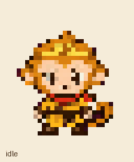

# 悟空 · Wukong

> 俺老孙来也~！

孙悟空形象启发的 Q 版小猴子：金箍、红围巾、卷尾巴，陪你一起写代码。每帧采用 **32×32 逻辑像素**，包含 **9 种动画状态**和 **16 个视线方向**。



## 如何导入 Codex

需要已安装并支持自定义宠物的 Codex 桌面客户端。

1. 复制下面的完整链接，粘贴到浏览器地址栏并按回车。
2. 浏览器询问是否打开 Codex 时，选择打开。
3. 在 Codex 的宠物导入界面确认名称、简介和预览，完成导入。
4. 如果没有自动选中，在设置中的「Mini 与虚拟宠物」里选择「悟空」。

```text
codex://pets/install?name=%E6%82%9F%E7%A9%BA&imageUrl=https%3A%2F%2Fraw.githubusercontent.com%2FTintinding%2Fwukong-codex-pet%2Fmain%2Fwukong-v2.png&description=%E4%BF%BA%E8%80%81%E5%AD%99%E6%9D%A5%E4%B9%9F~%EF%BC%81&spriteVersionNumber=2
```

GitHub 可能不会把 `codex://` 显示为可点击链接，因此请复制整行到地址栏。Windows 用户也可以[下载导入快捷方式](https://raw.githubusercontent.com/Tintinding/wukong-codex-pet/main/install-wukong.url)，保存后双击打开。

导入链接直接读取本仓库的透明 PNG；每个人会在自己的宠物列表中导入一份。无需原作者的账号或宠物 ID，也不需要重新生成图片。

如果没有出现导入窗口，请确认 Codex 已安装、浏览器允许打开外部应用，并检查[精灵表原始图片](https://raw.githubusercontent.com/Tintinding/wukong-codex-pet/main/wukong-v2.png)能否打开。旧版客户端可能需要更新。

## 文件说明

| 文件 | 用途 |
| --- | --- |
| [wukong-v2.png](wukong-v2.png) | **导入使用这张图**：1536×2288 透明 PNG，v2 精灵表 |
| [wukong-32px.png](wukong-32px.png) | 每帧 32×32 的逻辑像素原图，供查看和编辑 |
| [all-states.gif](all-states.gif) | 9 种动画状态的连续预览 |
| [idle.gif](idle.gif) | 待机动画预览 |
| [contact-sheet.png](contact-sheet.png) | 动作与视线方向总览 |
| [install-wukong.url](install-wukong.url) | Windows 导入快捷方式 |
| [SHA256SUMS.txt](SHA256SUMS.txt) | 导入精灵表的 SHA-256 校验值 |

精灵表采用 v2 布局：前 9 行是动画，后 2 行是顺时针排列的 16 个视线方向。导入图经过整数倍最近邻放大，以保留清晰的 32×32 像素边缘。请勿改成 JPEG、裁剪或打乱排列后再导入。

本仓库提供宠物外观与动画；鼠标悬停显示套餐剩余用量等交互取决于 Codex 客户端，素材本身不包含这些功能。

## English import guide

Wukong is a Monkey King inspired companion with 32×32 logical pixel frames, nine animation states and sixteen look directions. Description: **俺老孙来也~！**

Copy the full `codex://pets/install` link above into your browser address bar. Allow the browser to open the Codex desktop app, review the pet and complete the import. Then select Wukong in your pet settings if needed. On Windows, you can also download and open `install-wukong.url`.

Use `wukong-v2.png` for import. The smaller `wukong-32px.png` is the logical pixel sheet for inspection or editing. The installation uses the original PNG from this repository, so no image regeneration is needed.

Import URL format: [official desktop deep-link reference](https://learn.chatgpt.com/docs/reference/commands). Artwork created with the Pets workflow and image generation, then assembled and validated as a v2 sprite sheet.

